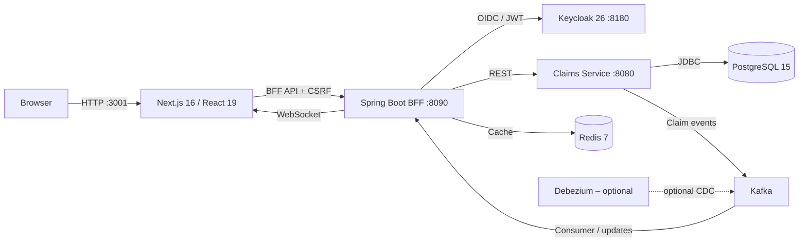

# Application Architecture

## Responsibilities
- UI: login/signup, claims list, claim wizard, claim details.
- BFF: UI-facing API, authentication integration, orchestration, cache/event/WebSocket integration.
- Claims Service: claim domain operations, persistence and event publication.
- Keycloak: identity provider and OAuth2/OIDC tokens.
- PostgreSQL: durable data; Redis: cache; Kafka: asynchronous events.
- Debezium is optional; configured default is direct Kafka publishing.

## Trust boundaries
Browser↔BFF (authentication/CSRF/validation); BFF↔Claims Service (REST mapping/downstream errors); services↔Keycloak (JWT/JWK/roles); Claims Service↔PostgreSQL (persistence/ownership); services↔Kafka/Redis (events/cache).
